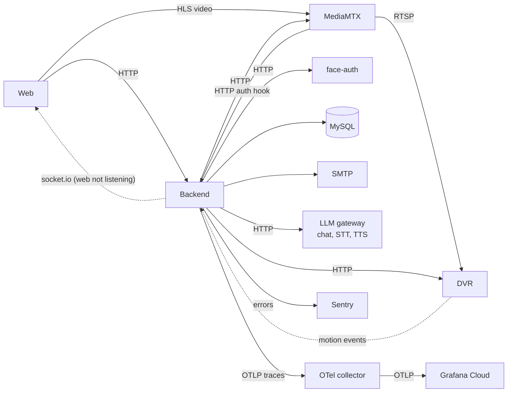
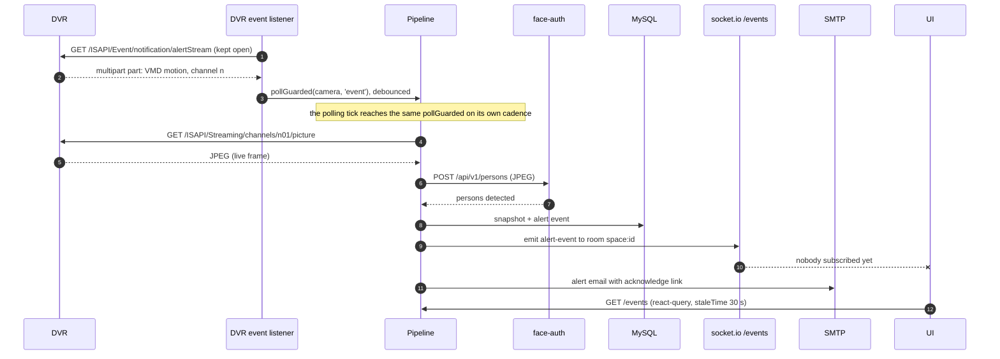
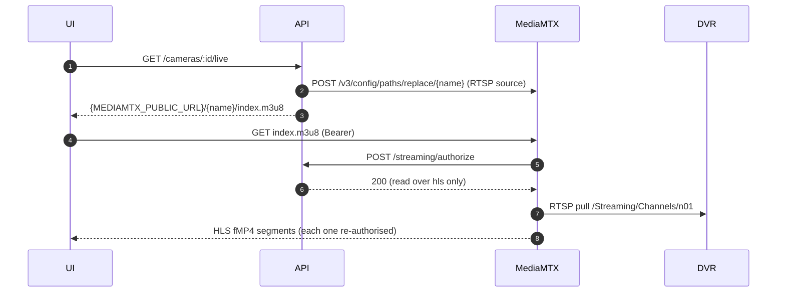

# Communication map

Who talks to whom, over what, and who starts it. Every arrow points from the side that opens the
connection. Paths are relative to `/api/v1` unless they start with `/ISAPI`, `/v3` or a full URL.

Keep this file in step with the code (the component diagram is copied into `README.md`; change both): a PR that adds or changes a controller route, a gateway event,
an ISAPI call, a MediaMTX call or an outbound client updates the diagram in the same PR.

## Components

Arrow = who calls whom. Solid = HTTP request/response. Dashed = push.

The DVR's motion events ride a connection the backend opens and keeps open (`alertStream`); the
DVR never connects to the backend.

The bottom row is optional: each one is off unless its env is set (`ASSISTANT_ENABLED`,
`OTEL_ENABLED`, `SENTRY_DSN`), and the core flow does not depend on any of them. The collector is
our own process on the app host (`ops/otel-collector`) and ships **traces only**. The backend also
exposes `GET /metrics` for Prometheus, but nothing in this repo scrapes it, so metrics do not reach
Grafana today.

## Flow: motion on the recorder becomes an alert

## Flow: live view

## Known gaps

- **Realtime.** The backend emits `alert-event` on `/events`, but the UI has no socket.io client. It
  sees new alerts only when react-query refetches `GET /events`.
- **Email links.** `smtp-credential-delivery.service.ts` builds `/auth/magic` and
  `/auth/reset-password`. The UI routes are `/auth/magic-link` and `/auth/change-password`.
- **Routes with no UI caller.**
  - face login: `/auth/face/*`
  - password reset and magic link: `/auth/password-reset/*`, `/auth/magic-link/*`
  - recorder setup: `/dvr/discovery`, `/dvr/event-linkage`
  - cameras: `DELETE /cameras/:id`, `/cameras/:id/status`, `/cameras/:id/analyze`
  - single records: `GET /zones/:id`, `/events/:id/deliveries`
